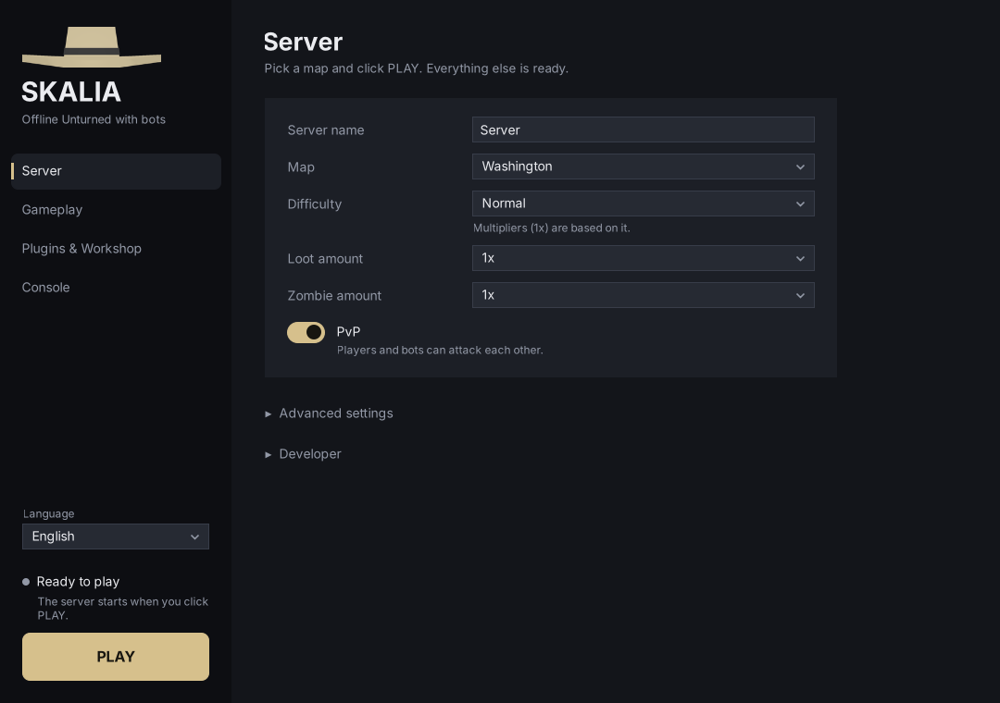
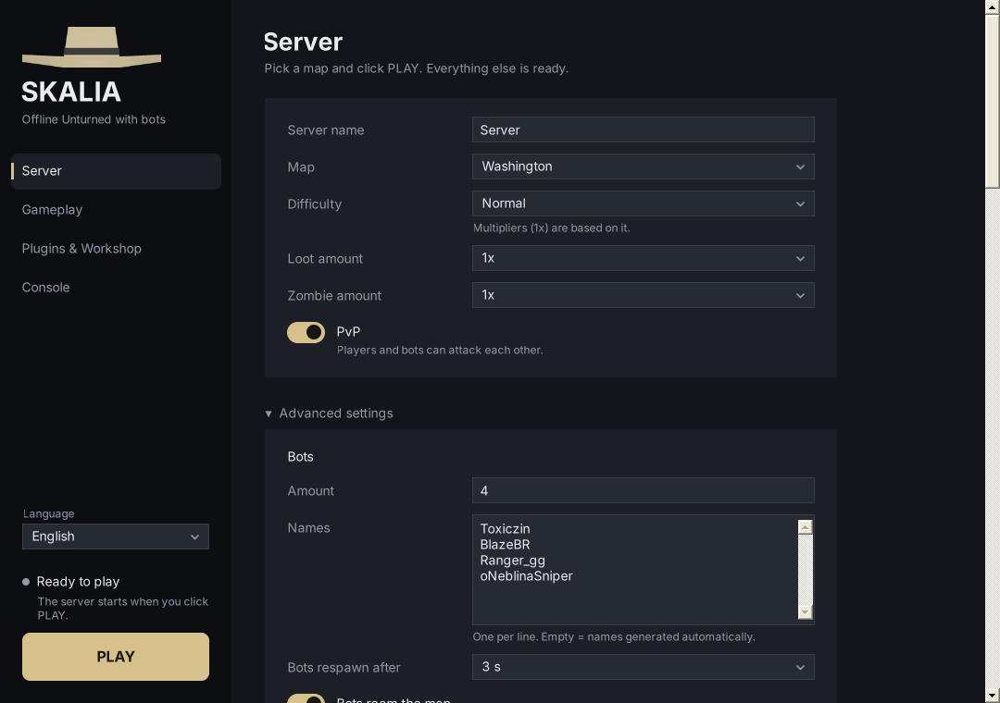
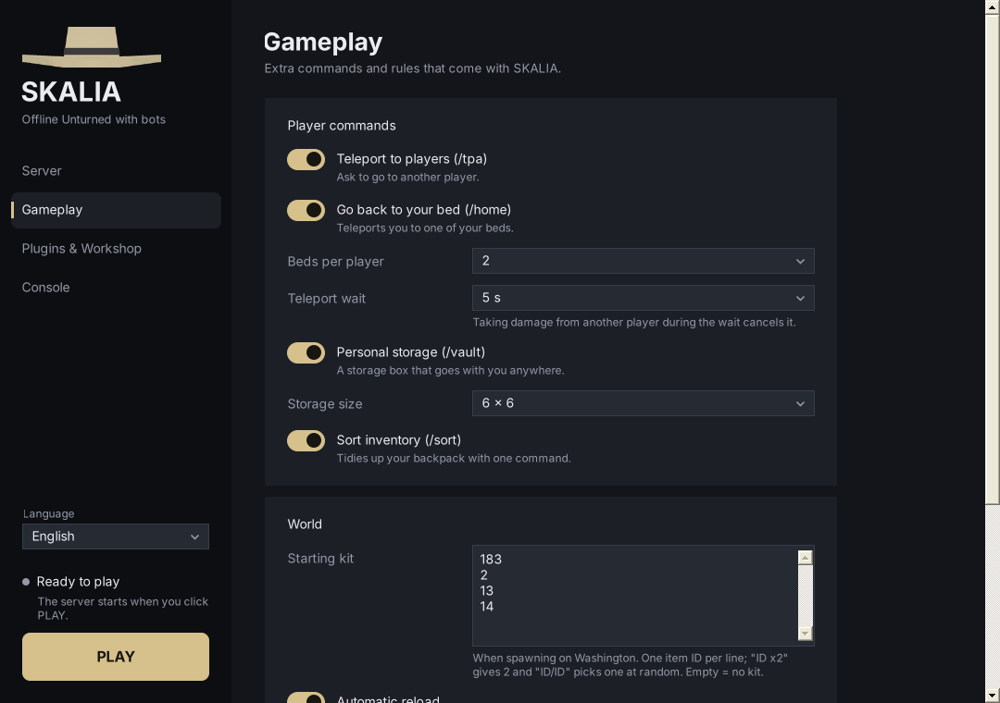

# SKALIA

Play Unturned offline with bots. SKALIA starts a private LAN server on your own
PC, using the Unturned Dedicated Server you already have from Steam, and puts
you in it with one click.

<p align="center">
  
</p>

SKALIA does not include or redistribute any Unturned files. It runs on top of
your own installation.

## Features

- **One click to play.** Pick a map, press PLAY, then JOIN GAME. SKALIA finds
  the Dedicated Server through your Steam libraries, installs
  [OpenMod](https://openmod.github.io/openmod-docs/) into it the first time,
  and opens Unturned connected to your server.
- **Bots that play like people.** Bots loot, fight zombies, take cover, hunt
  and heal. Their behaviour is measured from recordings of real players, not
  scripted by hand.
- **Bot difficulty, slider by slider.** Pick a profile (Default, Hard,
  Tryhard) or tune 32 modifiers across perception, shooting, movement,
  hunting, looting, survival and zombies. Default (everything at 1x) is exactly
  how the recorded players play. See [docs/MODIFIERS.md](docs/MODIFIERS.md).
- **Your rules.** Difficulty, loot up to 100x, zombie amount, PvP, day length,
  hunger, skills, death penalties, map and crosshair, camera, and more.
- **Starting kit per map.** List item IDs (with `x2` for amounts and `A/B` for
  a random pick) and every new spawn gets them.
- **Player commands.** Teleport requests (`/tpa`), beds as homes (`/home`), a
  personal vault (`/vault`) and inventory sorting (`/sort`), each one optional.
- **Workshop and plugins.** Add Workshop item IDs and drop extra OpenMod
  plugins in a folder.
- **English and Brazilian Portuguese**, for the launcher and the in-game
  messages.

<p align="center">
  
  
</p>

## Requirements

- Windows 10 or 11
- Steam, running and signed in
- **Unturned** (Steam)
- **Unturned Dedicated Server**, free on Steam under *Library > Tools*
- The **SKALIA DEPS** plugin (`SkaliaDeps.dll`) in a `plugins` folder next to
  `SKALIA.exe`. It runs the bots and the player commands. Its source is in
  [`src/Skalia.Deps`](src/Skalia.Deps).

## How to use

1. Put `SKALIA.exe` and its `plugins` folder anywhere, for example in
   `<Unturned Dedicated Server>\Skalia`, and open `SKALIA.exe`.
2. On **Server**, pick a map, a difficulty, and how much loot and how many
   zombies you want. Bots, bot difficulty, world rules and server options are
   under **Advanced settings**.
3. On **Gameplay**, choose which player commands are on and edit the starting
   kit.
4. Click **PLAY**. SKALIA prepares the server and loads the map. The first
   start also builds the bots' navigation, which can take up to 2 minutes.
5. When the button turns into **JOIN GAME**, click it. Unturned opens through
   Steam and connects to `127.0.0.1`. If Steam asks, choose to play without
   BattlEye.
6. Click **Save and stop server** when you are done, so your world is saved.

The world, saves and server config live in
`<Unturned Dedicated Server>\Servers\Skalia`. Launcher settings are saved in
`skalia.json` next to `SKALIA.exe`.

To connect by hand from Unturned (*Play > Connect*), use host `127.0.0.1`, port
`27025` (or the port set in SKALIA) and the password, if you set one.

SKALIA is free. If you paid for it, you were scammed.

## Building from source

Needs the [.NET SDK](https://dotnet.microsoft.com/download) 8 or newer and an
Unturned Dedicated Server install (the plugin compiles against its DLLs). From
the repository folder:

```
build.cmd
```

It builds `SKALIA.exe` and `plugins\SkaliaDeps.dll` next to it. See
[CONTRIBUTING.md](CONTRIBUTING.md) for the details, the project layout and the
rules for changing the bots.

## Documentation

| | |
|---|---|
| [CONTRIBUTING.md](CONTRIBUTING.md) | Building, project layout, how the bots work, recordings |
| [docs/MODIFIERS.md](docs/MODIFIERS.md) | Every bot difficulty modifier and the recorded data behind it |
| [KNOWN_ISSUES.md](KNOWN_ISSUES.md) | What is untested, reported or missing |
| [docs/LOGS.md](docs/LOGS.md) | Reading the bot lines of the server log |
| [DESIGN.md](DESIGN.md) | Visual rules for the launcher |
| [src/Skalia.Deps](src/Skalia.Deps) | The SKALIA DEPS plugin |

## License

MIT, see [LICENSE](LICENSE).

SKALIA is a fan project. It is not affiliated with or endorsed by Smartly
Dressed Games. Unturned is a trademark of Smartly Dressed Games.

## SKALIA DEPS commands

Typed in the game chat. Commands follow OpenMod permissions; the admin, bot and
development ones are meant for admins. The bot commands also work in the server
console.

### Players

| Command | What it does |
|---|---|
| `/tpa <player>` | Ask to teleport to a player |
| `/tpa a [player]` / `/tpa r [player]` | Accept / refuse a teleport request |
| `/tpa c` | Cancel your request |
| `/home [slot]` | Teleport to one of your claimed beds |
| `/homes` | List your beds and their names |
| `/renomear <bed> <new name>` | Rename one of your beds |
| `/vault` | Open your private, persistent storage |
| `/sort` | Sort your inventory |
| `/cv d` / `/cv wn` | Vote to skip the night / clear rain, storm or snow (alias `/callvote`) |
| `/kit` | Says that kits are not available (alias `/kits`) |
| `/statsui` | Show or hide the stats HUD (needs the Workshop interface pack) |

### Admin

| Command | What it does |
|---|---|
| `/admin <player\|SteamID>` | Give the Admin role (without the bot commands) |
| `/unadmin <player\|SteamID>` | Remove that Admin role |
| `/god [player] [on\|off]` | Toggle invulnerability |
| `/heal [player]` | Restore every status to 100% |
| `/clear [player]` | Empty a player's inventory |
| `/clearg` | Remove every item players dropped on the ground |
| `/clearv` | Remove every vehicle on the map |
| `/spy <player>` | Request a screenshot from a player |

### Bots

| Command | What it does |
|---|---|
| `/addbot <steamid64> <name>` | Register a new bot |
| `/callbot <name>` / `/callbots` | Bring one bot / every bot into the server |
| `/playbot <name>` / `/playbots` | Let one bot / every bot play |
| `/stopbot <name>` / `/stopbots` | Put one bot / every bot on standby |
| `/kickbots` | Remove every bot from the server |
| `/chat <bot> <message>` | Make a bot say something in chat |

### Development

Tools used to record players and tune the bots.

| Command | What it does |
|---|---|
| `/gravar` | Show the player recorder status |
| `/gravar ligar` / `/gravar parar` | Start / stop recording players |
| `/gravar bots ligar` / `/gravar bots parar` | Also record / stop recording the bots |
| `/gravar marca <note>` | Write a note into your own recording |
| `/navbot true [bot]` / `/navbot false` | Follow a bot's navigation on screen |
| `/navid` | Show the navmesh and spawn region where you stand |
| `/irpara <x> <y> <z>` | Teleport to coordinates from the bot logs |
| `/passagem a` / `/passagem b` | Mark the two ends of a passage for the bots |
| `/passagem lista` / `/passagem remover <n>` / `/passagem cancelar` | List, remove or cancel passages |
| `/malhanova [on\|off]` | Switch bot routes to the new navigation mesh |
| `/malhateste [half side in m]` | Build a test mesh around you and compare it with the zombies' mesh |
| `/zumbis limpar [radius]` | Clear zombies around you |
| `/zumbis pausar [radius]` | Keep clearing zombies around you (toggle) |
